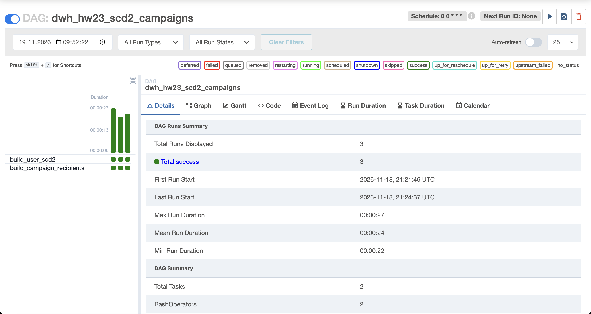
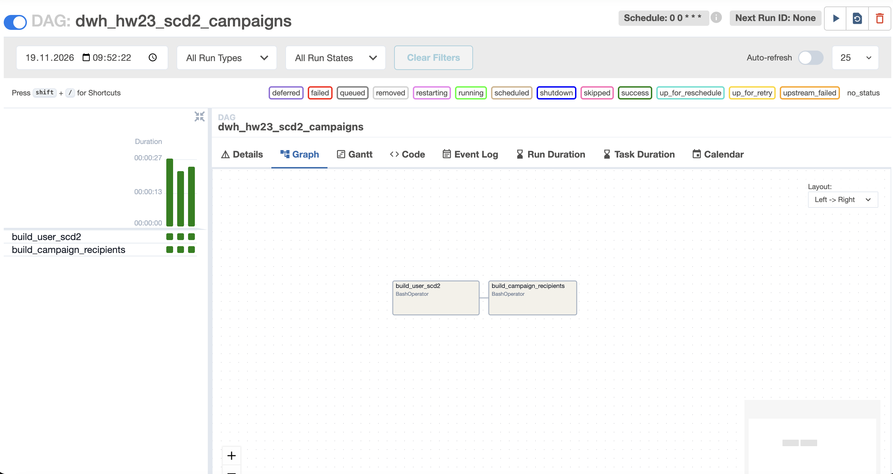
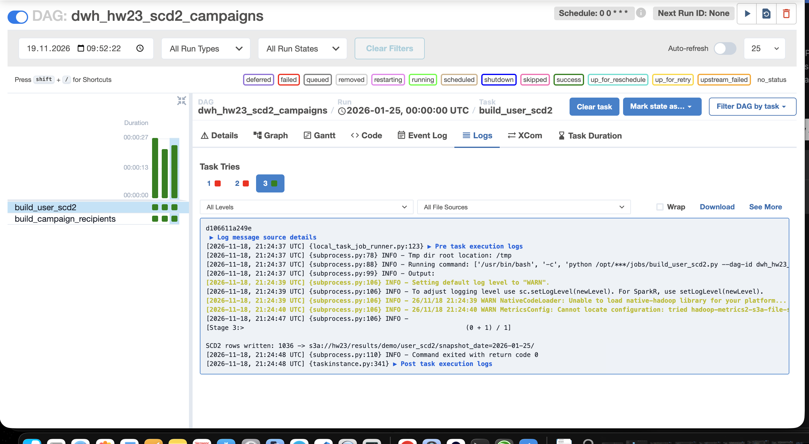

# Отчет по ДЗ 2.3

## 1. Окружение и данные
* **Airflow:** 2.10.5
* **Spark:** 3.5.4 (PySpark, режим `local[2]`)
* **Hadoop / S3A:** 3.3.4
* **S3 (RustFS):** 1.0.4
* **Java:** 17
* **Набор данных:** `data/demo`
* **Пути в S3:**
  * Исходные данные: `s3a://hw23/raw/demo/`
  * Результаты SCD2: `s3a://hw23/results/demo/user_scd2/snapshot_date=<D>/`
  * Результаты витрины: `s3a://hw23/results/demo/campaign_recipients/calculation_date=<D>/`

## 2. Архитектура DAG
DAG: `dwh_hw23_scd2_campaigns`
Расписание: `CronDataIntervalTimetable("0 0 * * *", timezone="UTC")`, `catchup=True`, `max_active_runs=1`, `retries=1`.
Зависимости задач: `build_user_scd2` → `build_campaign_recipients`.
Все обязательные метаполя (`_dag_id`, `_run_id`, `_task_id`, `_data_interval_start`, `_data_interval_end`, `_loaded_at`) заполняются из контекста Airflow и передаются в Spark-задания через CLI-аргументы.

**Скриншоты:**




## 3. Стратегия выполнения JOIN
При выполнении второй задачи (`build_campaign_recipients`) Spark читает витрину SCD2 (сотни строк) и справочник кампаний (25 строк). Поскольку таблица рассылок очень маленькая, Spark автоматически выбирает **Broadcast Hash Join**. Это наиболее оптимальная стратегия для данного объёма: таблица рассылок рассылается на все узлы-исполнители, что исключает дорогостоящий Shuffle.

## 4. Результаты проверок
Для проверки использовался скрипт `checks/run_checks.py`.

```
==================================================
ПРОВЕРКА SCD2
==================================================
[2026-01-23] Rows: 961, Users: 100, BadCurrent: 0, DupKeys: 0, NullMeta: 0
[2026-01-24] Rows: 995, Users: 100, BadCurrent: 0, DupKeys: 0, NullMeta: 0
[2026-01-25] Rows: 1036, Users: 100, BadCurrent: 0, DupKeys: 0, NullMeta: 0

==================================================
ПРОВЕРКА ВИТРИНЫ
==================================================
[2026-01-23] Rows: 53, DupCampUser: 0, BadLogic: 0
+-----------+-----+
|campaign_id|count|
+-----------+-----+
|         11|   10|
|         16|   23|
|         23|   20|
+-----------+-----+

[2026-01-24] Rows: 25, DupCampUser: 0, BadLogic: 0
[2026-01-25] Rows: 22, DupCampUser: 0, BadLogic: 0
```
## Вывод. Снимки SCD2 корректны (нет дублей ключей, ровно одна текущая версия на пользователя). Витрина собрана без дублей (campaign_id, user_id), исторические интервалы и домены соблюдены. Метаполя заполнены, Null-значений нет.

## 5. Повторный расчет и идемпотентность
Для проверки 5-го критерия данные за 23 января были сохранены в s3a://hw23/backup/. Затем задачи за 23 января были очищены через airflow tasks clear и перезапущены.

Сравнение бизнес-полей до и после перезапуска (исключая метаполя) через exceptAll показало:

text
Строк в старом: 961, в новом: 961
Разница (old - new): 0
Разница (new - old): 0
РЕЗУЛЬТАТ: Идемпотентность подтверждена. Бизнес-данные идентичны.
Вывод: Повторный расчет не изменил бизнес-результат и не создал дублей. Остальные партиции (24 и 25 января) не были затронуты.
